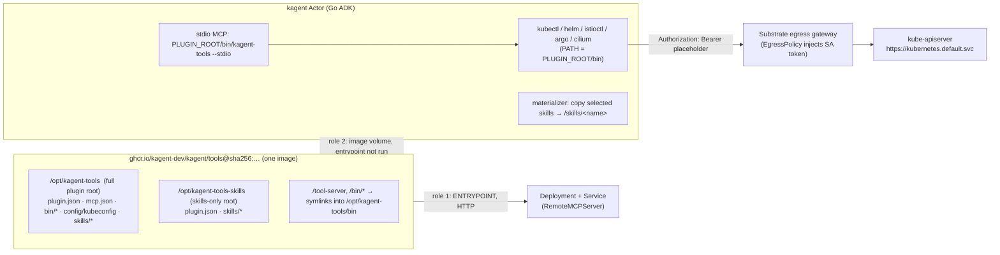

# kagent-tools as an OCI Skills Bundle for kagent 1.x — Design

Status: Draft for review · Date: 2026-10-24 · Target: kagent `v1.0.0-alpha7`+ (`api.kagent.dev/v1alpha3`, Substrate runtime)

## 1. Goal

Ship **one OCI image** from this repository that works in two roles:

1. **MCP server** (today): `Deployment` + `Service`, consumed by kagent as a `RemoteMCPServer`.
2. **kagent 1.x skills bundle** (new): referenced from an `AgentTemplate` as a digest-pinned
   `spec.plugins[].source.oci`. kagent mounts the image into the agent Actor, installs the
   selected skills, and starts the bundled `kagent-tools` binary as a **stdio MCP server inside
   the agent**. The binary drives the bundled CLIs: `kubectl`, `helm`, `istioctl`,
   `kubectl-argo-rollouts`, and `cilium`.

Success criteria:

- A Go ADK agent that references only the image (no `RemoteMCPServer`) can list skills,
  load a skill, and call `k8s_*`, `helm_*`, `istio_*`, `argo_*`, and `cilium_*` tools against its cluster.
- The existing Helm chart and `RemoteMCPServer` usage keep working with the same image.
- Least privilege is enforced by Kubernetes RBAC on an injected ServiceAccount token. No
  credential enters the image or the agent environment.

Non-goals: Python ADK support (kagent's Python ADK does not consume the `agent_plugins`
contract yet), Claude-format plugins, Git/S3 delivery, and a new kagent CLI command.

## 2. How kagent 1.x consumes OCI skills (verified in `kagent-dev/kagent@e8eee57`)

| Fact | Source |
|---|---|
| `AgentTemplate.spec.skills[]` (`{name, source}`) and `spec.plugins[]` (`{source, skills[]}`); `source.oci` must be `repo@sha256:…`; `source.path` selects a sub-directory | `go/api/v1alpha3/agenttemplate_types.go` |
| Each distinct image is a read-only **image volume** at `/run/kagent/artifacts/<sha256(ref)>`. The entrypoint is **never run**, and there is no in-runtime pull | `go/core/internal/substrate/actor_template.go`, `translator/skills.go` |
| Files outside `source.path` are ignored | `docs/architecture/configuration-and-compilation.md` |
| Agent Plugin root = `plugin.json` with `$schema: https://agent-plugins.org/schemas/1.0.0/plugin.schema.json`; selected skills are copied from `<root>/skills/<name>` to `/skills/<name>` | `go/core/pkg/agentplugins/materialize.go` |
| `<root>/mcp.json` (`$schema …/mcp.schema.json`) may declare **stdio** servers: `command` bare or `./`-relative, `${PLUGIN_ROOT}`/`${PLUGIN_DATA}` expanded in `args`/`env`, `cwd` defaults to the plugin root, env is **appended to the runtime env** (last wins) | `materialize.go` `parseMCPServer`, `go/adk/pkg/mcp/registry.go` |
| Only the **Go ADK** (`kagent` harness) loads plugin `mcp.json`. Codex/Claude install the skills only | `go/adk/pkg/config/agentplugins.go` |
| Package validation per selected root: **≤ 10,000 entries, ≤ 100 MiB of regular files**, only files/dirs/symlinks, symlinks must stay inside the root | `materialize.go` `validatePackage` |
| Runtime images ship only `bash ca-certificates git`; there is no `kubectl` or `helm` | `go/Dockerfile` |
| Egress is deny-by-default. `EgressPolicy` grants origins and can inject a Secret into a header through a MITM gateway whose CA is at `/run/kagent/egress/trust-bundle.pem`. The gateway replaces a header; it never adds one | `docs/architecture/egress-policies.md`, `credential-injection.md` |
| Up to 29 distinct skill images per Actor | `configuration-and-compilation.md` |

### Measured sizes (linux/amd64)

| File | Size |
|---|---|
| `kagent-tools` (`-s -w -trimpath`) | 74 MB |
| `kubectl` 1.37.0 | 62 MB |
| `helm` 4.3.0 | ~70 MB |
| `istioctl` 1.31.1 | ~100 MB |
| `kubectl-argo-rollouts` 1.10.0 | 142 MB |
| `cilium` 0.20.0 | ~200 MB |
| **Plugin root total** | **~650 MB** |

**Blocking constraint:** the full bundle exceeds kagent's 100 MiB package limit (`kagent-tools`
plus `kubectl` alone is 136 MB). The bundle **requires an upstream kagent change** (§6). A
skills-only plugin root, which fits today, provides the fallback (§5.5).

## 3. Approaches considered

| | Approach | Pros | Cons |
|---|---|---|---|
| **A (chosen)** | **Dual-use image**: restructure the existing distroless image so everything lives under the Agent Plugin root `/opt/kagent-tools`; legacy paths become symlinks | One image and one digest for both roles; no drift between server and bundle; matches the request | Needs the upstream size-limit change; adds ~2 MB of distroless files to the volume (ignored) |
| B | Separate `FROM scratch` `tools-plugin` image with the same contents | Matches kagent's "build from scratch" guidance literally | Two images to release and pin, and the same upstream change is still required |
| C | Skills-only plugin plus the existing `RemoteMCPServer` | Works on current kagent | CLIs are not in the bundle; still needs a separate Deployment |

A is chosen. C ships **inside the same image** as a second plugin root, so the image is useful
before the upstream change lands.

## 4. Architecture



### 4.1 Image layout

```
/opt/kagent-tools/                    # full plugin root  (source.path: opt/kagent-tools)
  plugin.json                         # name "kagent-tools", version = image VERSION
  mcp.json                            # stdio server "kagent-tools"
  bin/kagent-tools                    # the MCP server (stripped)
  bin/kubectl  bin/helm  bin/istioctl  bin/kubectl-argo-rollouts  bin/cilium
  config/kubeconfig                   # egress-gateway kubeconfig (no secrets)
  skills/<skill-name>/SKILL.md        # + optional references/*.md
/opt/kagent-tools-skills/             # skills-only root (source.path: opt/kagent-tools-skills)
  plugin.json                         # name "kagent-tools-skills"
  skills/<skill-name>/...             # identical copy of the skills
/tool-server  -> /opt/kagent-tools/bin/kagent-tools   # backward compatibility
/bin/{kubectl,helm,...} -> /opt/kagent-tools/bin/...  # backward compatibility
ENV PATH=/opt/kagent-tools/bin:$PATH
ENTRYPOINT ["/opt/kagent-tools/bin/kagent-tools"]
```

The legacy symlinks sit **outside** both plugin roots, so they never violate kagent's
"symlinks must stay inside root" rule. All files are owned by `65532:65532` with mode `0755`
for binaries and `0644` for data. Both plugin roots hold only regular files and dirs.

Source of truth in the repo: a new top-level `plugin/` directory (`plugin.json.tmpl`,
`skills-plugin.json.tmpl`, `mcp.json`, `config/kubeconfig`, `skills/`). The Dockerfile
renders the manifests with `VERSION` in a build stage and assembles both roots.

### 4.2 `mcp.json`

```json
{
  "$schema": "https://agent-plugins.org/schemas/1.0.0/mcp.schema.json",
  "mcpServers": {
    "kagent-tools": {
      "type": "stdio",
      "command": "./bin/kagent-tools",
      "args": ["--stdio"],
      "env": {
        "PATH": "${PLUGIN_ROOT}/bin:/usr/local/bin:/usr/bin:/bin",
        "KAGENT_TOOLS_DEFAULT_KUBECONFIG": "${PLUGIN_ROOT}/config/kubeconfig",
        "KAGENT_USE_STDERR": "true",
        "HOME": "${PLUGIN_DATA}",
        "XDG_CACHE_HOME": "${PLUGIN_DATA}/cache",
        "XDG_CONFIG_HOME": "${PLUGIN_DATA}/config",
        "XDG_DATA_HOME": "${PLUGIN_DATA}/data"
      }
    }
  }
}
```

- The plugin root is a read-only mount, so every CLI cache and config directory (helm repos,
  kubectl discovery cache, istioctl) is redirected to the writable `${PLUGIN_DATA}`.
- Stdout carries the MCP protocol. Logs go to stderr (`KAGENT_USE_STDERR`).
- Because `mcp.json` env overrides the runtime env, it sets only **defaults**
  (`KAGENT_TOOLS_DEFAULT_*`). Operator-tunable settings come from Harness env vars that
  `mcp.json` leaves untouched (§4.3).

### 4.3 `kagent-tools` server changes

All changes are backward compatible:

1. **Env fallbacks for flags.** If a flag is not set explicitly, read it from the environment:
   `KAGENT_TOOLS_TOOLS` (comma-separated) → `--tools`, `KAGENT_TOOLS_READ_ONLY` → `--read-only`.
   Operators tune the in-agent server through Harness env without rebuilding the image.
   Precedence: flag > env > default.
2. **Kubeconfig resolution:** `--kubeconfig` > `KUBECONFIG` > `KAGENT_TOOLS_DEFAULT_KUBECONFIG`
   > in-cluster (empty). When the resolved path is non-empty, the server exports it as
   `KUBECONFIG` for its own process, because today only the `k8s` and `kubescape` providers
   receive the flag. Every child CLI (helm, istioctl, cilium, argo) then uses the same cluster.
   This also fixes a latent inconsistency for HTTP-mode users who pass `--kubeconfig`.
3. Logic lives in `cmd/` as a small, unit-tested `resolveServerConfig(flags, lookupEnv)`
   function that returns a typed config struct. No new public packages.
4. **Fix the stdio stream corruption.** When no `OTEL_EXPORTER_OTLP_ENDPOINT` is set,
   `internal/telemetry` falls back to `stdouttrace`, which writes spans to **stdout** and breaks
   the MCP stdio protocol. In stdio mode, the console exporter must write to stderr.
   `run()` sets `KAGENT_USE_STDERR=true` when `--stdio` is set, and `createExporter` writes the
   console exporter to stderr when that variable is `true`.

### 4.4 Cluster access from the Actor

`config/kubeconfig` (static, in the image):

```yaml
apiVersion: v1
kind: Config
clusters:
- name: in-cluster
  cluster:
    server: https://kubernetes.default.svc
    certificate-authority: /run/kagent/egress/trust-bundle.pem
users:
- name: kagent-egress
  user:
    token: kagent-credential-injected
contexts:
- name: default
  context: {cluster: in-cluster, user: kagent-egress}
current-context: default
```

User-side setup (documented in `docs/kagent-skills.md` with a complete example):

```yaml
apiVersion: v1
kind: ServiceAccount
metadata: {name: kagent-tools-agent, namespace: kagent}
---
apiVersion: v1
kind: Secret
metadata:
  name: kagent-tools-agent-token
  namespace: kagent
  annotations: {kubernetes.io/service-account.name: kagent-tools-agent}
type: kubernetes.io/service-account-token
---
# Bind a ClusterRole: "view" for read-only agents, a custom role for write tools.
apiVersion: api.kagent.dev/v1alpha3
kind: EgressPolicy
metadata: {name: kube-api, namespace: kagent}
spec:
  destinations:
  - origin: https://kubernetes.default.svc
    authentication:
      header: Authorization
      prefix: "Bearer "
      secretKeyRef: {name: kagent-tools-agent-token, key: token}
---
apiVersion: api.kagent.dev/v1alpha3
kind: AgentTemplate
metadata: {name: k8s-operator, namespace: kagent}
spec:
  systemPrompt: "Use the kagent-tools skills and tools to operate the cluster."
  plugins:
  - source:
      oci: ghcr.io/kagent-dev/kagent/tools@sha256:<digest>
      path: opt/kagent-tools
    skills: [k8s-troubleshooting, helm-release-management]
---
apiVersion: api.kagent.dev/v1alpha3
kind: Agent
metadata: {name: k8s-operator, namespace: kagent}
spec:
  template: {ref: {name: k8s-operator}}
  harnessRef: {name: kagent}          # Go ADK harness
  egressPolicyRefs: [{name: kube-api}]
```

Security properties: the token never enters the guest; RBAC on `kagent-tools-agent` is the real
authorization boundary; setting `KAGENT_TOOLS_READ_ONLY=true` on the Harness also hides write
tools from the model.

### 4.5 Skills (initial set, one per provider)

Each skill is an `agentskills.io`-compliant `SKILL.md`: `name` matches the directory and the
pattern `^[a-z0-9]+(-[a-z0-9]+)*$` (≤ 64 chars), and `description` is ≤ 1024 chars and states
*when* to use the skill. The skill bodies are **playbooks that call the MCP tool names**, not
shell scripts. The bash tool's `PATH` does not include the plugin `bin/`, and a skill cannot
know the hashed mount path. Tool names are identical in plugin mode and RemoteMCPServer mode,
so the same skills serve both roots.

| Skill | Primary tools (exact names verified against `RegisterTools` during implementation) |
|---|---|
| `k8s-troubleshooting` | `k8s_*` get/describe/logs/events tools |
| `helm-release-management` | `helm_list_releases`, `helm_get_release`, `helm_upgrade`, `helm_uninstall`, `helm_repo_add`, `helm_repo_update` |
| `istio-traffic-debugging` | `istio_proxy_status`, `istio_proxy_config`, `istio_analyze_cluster_configuration`, waypoint tools |
| `argo-rollouts-progressive-delivery` | `argo_rollouts_list`, `argo_promote_rollout`, `argo_pause_rollout`, `argo_set_rollout_image` |
| `cilium-network-debugging` | `cilium_status_and_version`, endpoint, identity, policy, and BGP tools |
| `kubescape-security-posture` | `kubescape_*` |
| `prometheus-observability` | `prometheus_*` (needs `PROMETHEUS_URL` on the Harness env and an EgressPolicy) |

Each skill separates read-only from mutating steps and tells the model to confirm with the user
before any mutating call.

## 5. Behaviour and error handling

1. **Package rejection:** if the materializer rejects the package (size, symlink, schema),
   kagent fails the agent with the materializer error. The bundle must not trip anything except
   the size limit (§6), and CI checks the rest (§7).
2. **Missing EgressPolicy or RBAC:** CLIs return connection or 401/403 errors. These surface as
   existing tool errors. `docs/kagent-skills.md` § Troubleshooting maps these errors to the
   EgressPolicy, Secret, and RBAC setup. No code change is needed.
3. **Streaming operations** (`exec`, `logs -f`, `port-forward`) need HTTP upgrade through the
   gateway. These are unverified, so the e2e test checks them, and the docs list them as
   *best effort* until confirmed.
4. **Unsupported harness** (Python ADK, Codex, Claude): skills install, but no MCP tools start.
   The docs point those users at the skills-only root plus `RemoteMCPServer`.
5. **Skills-only fallback:** on kagent builds without the §6 change, use
   `path: opt/kagent-tools-skills` with the existing Helm-deployed server as a `RemoteMCPServer`.
   **Do not** select both roots in one agent, because duplicate skill names make kagent reject
   the selection.

## 6. Upstream dependency (kagent PR)

In `go/core/pkg/agentplugins/materialize.go`, skip `maxPackageBytes` for **platform-mounted**
sources (`source.Directory != ""`). These are read-only image volumes that are never copied or
downloaded by the runtime. Keep the entry-count, file-type, and symlink checks. Bytes copied
into `/skills` stay bounded by applying the existing 100 MiB budget inside `copySkill`. This
keeps protection where data is actually copied and lets large toolchain bundles through.
Track it as a prerequisite issue in `kagent-dev/kagent`. Until it merges, only the
skills-only root is usable.

## 7. Testing

| Layer | What |
|---|---|
| Unit (`cmd/`) | `resolveServerConfig` precedence table: flags, env fallbacks, kubeconfig chain, `KUBECONFIG` export |
| Unit (`plugin/plugin_test.go`) | Parse `plugin.json`/`mcp.json` with `DisallowUnknownFields` into typed structs mirroring kagent's; check schemas, the name pattern, `./`-relative command, env keys (no `PLUGIN_ROOT`/`PLUGIN_DATA` overrides); every `skills/*/SKILL.md` frontmatter is valid, `name` matches its directory, and every referenced tool name exists in the registered tool set |
| Image (`make plugin-verify`) | Build the image, `docker create` + `docker export`, then assert: both roots exist, binaries are executable, no symlink escapes either root, entries < 10,000, the skills-only root is < 100 MiB, `/tool-server --version` still works |
| Stdio smoke | Run `/opt/kagent-tools/bin/kagent-tools --stdio` in the image with MCP `initialize` + `tools/list` over stdin. Assert the tool list is non-empty |
| E2E (`test/e2e`, opt-in) | On a kagent 1.x Kind install with the §6 patch: apply the §4.4 manifests, invoke the agent, assert `list_skills` contains the selected skills and a `k8s_get_resources` call succeeds; best-effort check of pod logs |
| Regression | Existing Helm tests and e2e on the restructured image, with no chart changes needed |

## 8. Risks and open questions

| Risk | Mitigation |
|---|---|
| The upstream size-limit change is rejected | Ship approach C (skills-only root). A trimmed image does not help, because `kagent-tools` + `kubectl` alone is 136 MB |
| Gateway MITM breaks apiserver TLS or upgrades | E2E verifies it. Document `exec`/streaming as best effort |
| ~650 MB volume per Actor increases cold-start time | Worker image cache is shared with workload images. A future slim image could drop `cilium`/`argo` |
| Multi-arch index resolution by Substrate image volumes | Verify in e2e on arm64. Fall back to pinning the per-arch digest in docs |
| `mcp.json` env overrides the Harness `PATH` | The plugin `PATH` includes standard system dirs, and only the stdio server sees it |
